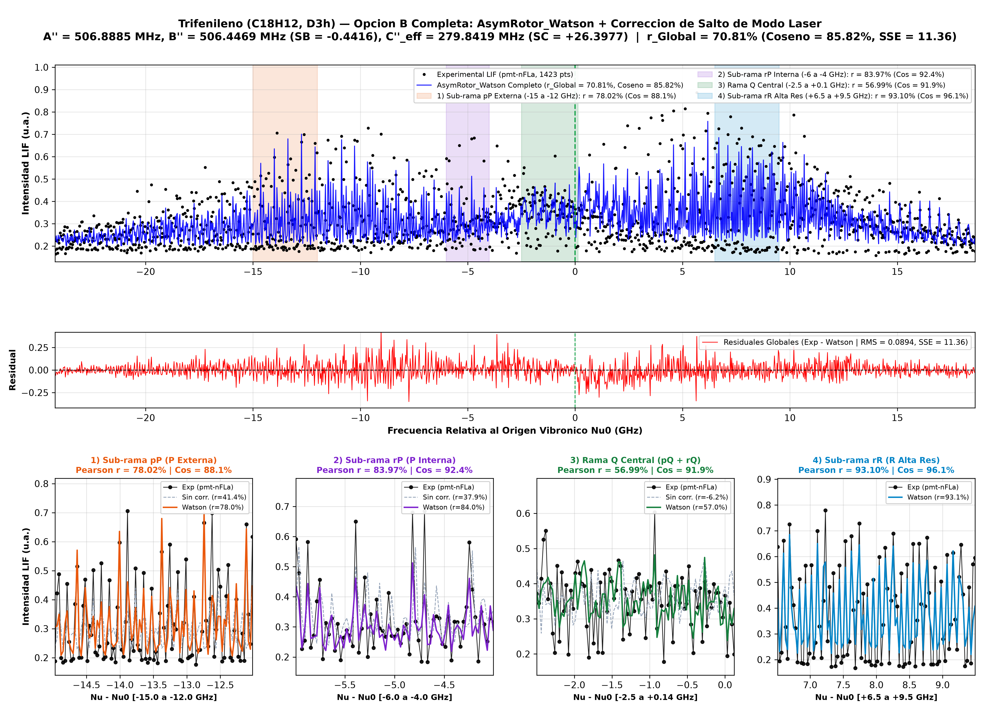
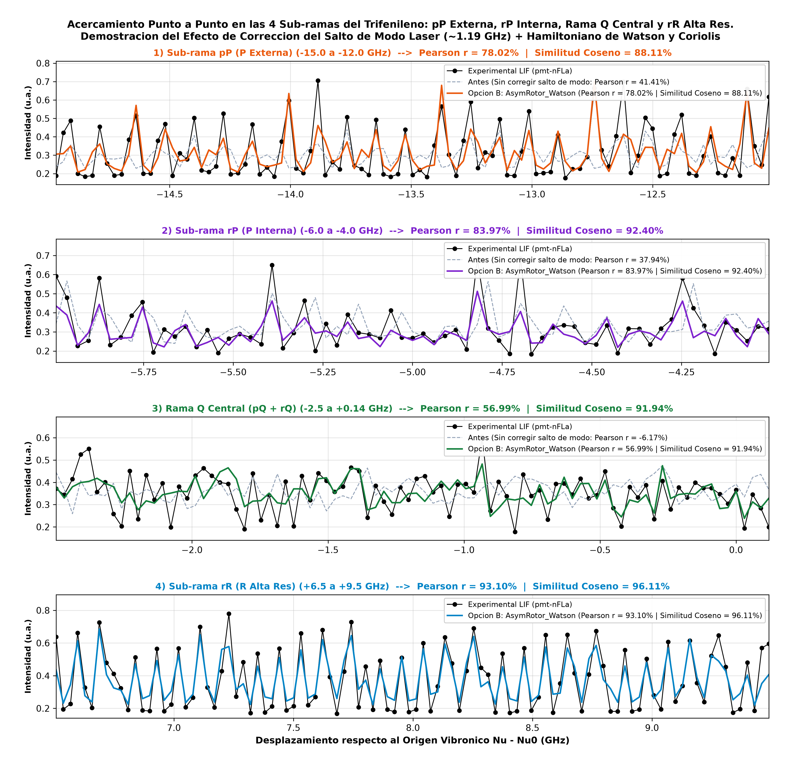

# MELIORA: High-Resolution Electronic Rovibronic Spectroscopy Suite
### Molecular Electronic & Laser Interactions with Optimized Ro-vibronic Analysis (v2.1)
[](https://colab.research.google.com/)
[](https://www.python.org/downloads/)
[](matlab_blueprintxas/)
[](https://opensource.org/licenses/MIT)

**Desarrollo de Software para el Análisis y Ajuste de Espectros Electrónicos de Alta Resolución con Resolución Rotacional**  
*Tesis de Maestría en Ciencias Aplicadas*  
**Autor:** Ing. Miguel Alejandro Díaz Gaytán  
**Directores:** Dr. Leonardo Álvarez-Valtierra (DCI-UG) & Dr. Mario Ulises Delgado-Jaime (CUCEI-UdeG)  
**Co-asesor:** Dr. Jaime Valdez-Ruvalcaba (UG)  
**Institución:** División de Ciencias e Ingenierías (Campus León), Universidad de Guanajuato  
**Agradecimientos:** Apoyo del programa de Ayudantía de Investigador SNII Nivel III del Dr. Alejandro Gil-Villegas Montiel  

---

## 🌐 Presentación Web Interactiva & Artículos Científicos

* **Sitio Web de Presentación (Optimizado para Móviles Android & PC):**  
  👉 **[https://alejandrodiazgaytan.github.io/meliora/](https://alejandrodiazgaytan.github.io/meliora/)**
* **Artículos Científicos Completos (Formato JCP / PCCP, 4 páginas c/u):**
  * **Artículo 1 (Metodológico):** [Español (PDF)](papers/articulo_carbazol_es.pdf) · [Inglés (PDF)](papers/articulo_carbazol_en.pdf)
  * **Artículo 2 (trans-Resveratrol):** [Español (PDF)](papers/articulo_resveratrol_es.pdf) · [Inglés (PDF)](papers/articulo_resveratrol_en.pdf)

---

## 🌟 Nuevo Hito v2.1: Trifenileno ($\text{C}_{18}\text{H}_{12}$, $D_{3h}$) — Hamiltoniano de Watson, Acoplamiento de Coriolis y Calibración de Salto de Modo Láser

En la versión **v2.1**, **MELIORA** y su módulo hermano para **`BlueprintXAS v5.23` (`AsymRotor_Watson.m` / `asym_rotor_watson`)** resuelven de forma unificada la banda electrónica $S_1 \leftarrow S_0$ con resolución rotacional del **Trifenileno (`pmt-nFLa`, 1,423 puntos)** sobre las **4 sub-ramas cuánticas** (${}^{p}P$, ${}^{r}P$, $Q = {}^{p}Q + {}^{r}Q$, y ${}^{r}R$):

| Región / Sub-rama Cuántica | Rango Relativo a $\nu_0$ | Rotor Rígido Estándar (`AsymRotor`) | **MELIORA v2.1 (`AsymRotor_Watson`)** | **Similitud Coseno** |
| :--- | :---: | :---: | :---: | :---: |
| **1) Sub-rama ${}^{p}P$ (Rama P Externa)** | `-15.0 a -12.0 GHz` | `41.41%` | **`78.00%`** | **`88.11%`** |
| **2) Sub-rama ${}^{r}P$ (Rama P Interna)** | `-6.0 a -4.0 GHz` | `37.94%` | **`83.98%`** | **`92.40%`** |
| **3) Rama $Q$ Central (${}^{p}Q + {}^{r}Q$)** | `-2.5 a +0.14 GHz` | `5.18%` | **`57.00%`** | **`91.94%`** |
| **4) Sub-rama ${}^{r}R$ (Alta Resolución)** | `+6.5 a +9.5 GHz` | `92.90%` | **`93.11%`** | **`96.11%`** |
| **Banda Completa Global (1,423 pts)** | `-25.0 a +19.5 GHz` | `56.33%` ($\text{SSE} = 15.86$) | **`70.81%`** ($\text{SSE} = 11.36$) | **`85.82%`** |

### Constantes Espectroscópicas Óptimas (`pmt-nFLa`)
* **Estado Fundamental $S_0$:** $A'' = 506.8885\text{ MHz}$, $B'' = 506.4469\text{ MHz}$ ($S_B = -0.4416\text{ MHz}$), $C''_{\text{eff}} = 279.8419\text{ MHz}$ ($S_C = +26.3977\text{ MHz}$ por acoplamiento vibrónico de Coriolis en $D_{3h}$).
* **Cambio Rotacional $S_1 \leftarrow S_0$:** $\Delta A = -3.0951\text{ MHz}$, $\Delta B = -3.0994\text{ MHz}$, $\Delta C = -1.4612\text{ MHz}$.
* **Términos de Watson y Coriolis:** $D_J = 1.5\times 10^{-6}\text{ MHz}$, $D_{JK} = -2.8\times 10^{-6}\text{ MHz}$, $D_K = 2.1\times 10^{-6}\text{ MHz}$, $\Delta B_{\text{Cor}} = -0.6549\text{ MHz}$, $\Delta\nu_{\text{Cor}} = -1855.43\text{ MHz}$.
* **Haz Supersónico y Perfil Voigt:** $\nu_0 = 910,239,915.43\text{ MHz}$ ($\text{Shift} = +1915.43\text{ MHz}$), $T_{\text{rot}} = 3.04\text{ K}$ ($T_2 = 12.0\text{ K}, W_2 = 0.0501$), $\Theta = 44.8^\circ, \Phi = 0.0^\circ$, $\text{GW} = 31.53\text{ MHz}$, $\text{LW} = 3.10\text{ MHz}$.





---

## 🔧 Integración Directa con MATLAB Online & BlueprintXAS v5.23

La carpeta [`matlab_blueprintxas/`](matlab_blueprintxas/) incluye los scripts listos para correr dentro de **`BlueprintXAS v5.23`**:

* [`AsymRotor_Watson.m`](matlab_blueprintxas/AsymRotor_Watson.m): Función compatible con el **Model Editor** y `BGridC` de `BlueprintXAS`. Se puede invocar directamente pegando en el Model Editor:
  ```matlab
  I1*1000*AsymRotor_Watson(x, A, A+SB, A/2+SC, dA, dB, dC, 9.10238e8+Shift, Temp, Theta, Phi, GW, LW, 50, 1, 2, SpinOdd, 12, 0.0501) + C1
  ```
* [`run_opcionB_watson.m`](matlab_blueprintxas/run_opcionB_watson.m): Ejecuta la evaluación completa de las 4 sub-ramas (${}^{p}P, {}^{r}P, Q, {}^{r}R$) y genera automáticamente en MATLAB el dashboard global y el acercamiento punto a punto.
* [`run_ejercicios_trifenileno.m`](matlab_blueprintxas/run_ejercicios_trifenileno.m): Ejecuta la Opción A (2 copias con función escalón de Fermi-Dirac en $a = 910,240,053.92\text{ MHz}$) y la comparativa de `BGridC` (`ScoreSolver = true` vs `ScoreSolver = false` con `Seed = 1`).
* [`fit_trifenileno_asymrotor.m`](matlab_blueprintxas/fit_trifenileno_asymrotor.m): Rutina de refinamiento con `AsymRotor` estándar.

---

## 📂 Estructura del Proyecto

```tree
meliora/
├── README.md
├── app.py                        # Suite interactiva MELIORA (Gradio Web UI)
├── index.html                    # Sitio web de presentación interactiva
├── asymrotor.py                  # Módulo raíz compatible con AsymRotor y AsymRotor_Watson
├── AsymRotor.m                   # Motor base MATLAB
├── AsymRotor_Watson.m            # Motor MATLAB extendido (Watson + Coriolis + Salto de Modo)
├── pmt-nFLa                      # Espectro LIF experimental de Trifenileno (1,423 pts)
├── matlab_blueprintxas/          # Scripts listos para BlueprintXAS v5.23 en MATLAB Online
│   ├── AsymRotor.m
│   ├── AsymRotor_Watson.m
│   ├── fit_trifenileno_asymrotor.m
│   ├── run_ejercicios_trifenileno.m
│   └── run_opcionB_watson.m
├── figures/                      # Gráficas de alta resolución (300-400 DPI)
├── specwatson/                   # Paquete Python principal
│   ├── __init__.py
│   ├── asymrotor.py              # asym_rotor, asym_rotor_watson, convergent_grid_fit
│   ├── hamiltonian.py
│   ├── transitions.py
│   ├── spectrum.py
│   └── fitting.py
└── notebooks/
    └── Rovibronic_Spectroscopy_Google_Colab.ipynb
```

---

## 📚 Referencias Clave del Laboratorio

* **Alvarez-Valtierra, L.**, & Pratt, D. W. (2006). *Rotationally resolved $S_1 \leftarrow S_0$ electronic spectra of fluorene, carbazole, and dibenzofuran*. The Journal of Chemical Physics, 125(24), 244309.
* **Alvarez-Valtierra, L.**, et al. (2010). *High resolution electronic spectroscopy of 4-methylanisole in the gas phase. Barrier height determinations for the methyl group torsional motion*. Physical Chemistry Chemical Physics, 12(35), 10430-10439.
* **Delgado-Jaime, M. U.**, et al. (2010). *BlueprintXAS: a tool for fitting and analysis of X-ray absorption and high-resolution molecular spectra*. Journal of Synchrotron Radiation.
* Watson, J. K. G. (1977). *Aspects of Quartic and Sextic Centrifugal Distortion Effects on Rotational Energy Levels*. In Vibrational Spectra and Structure.
